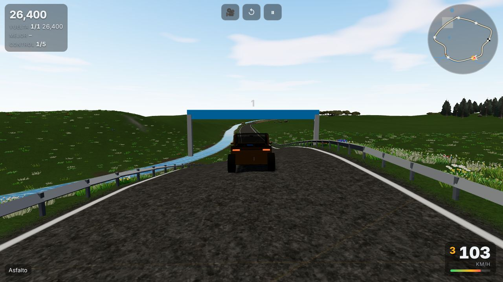
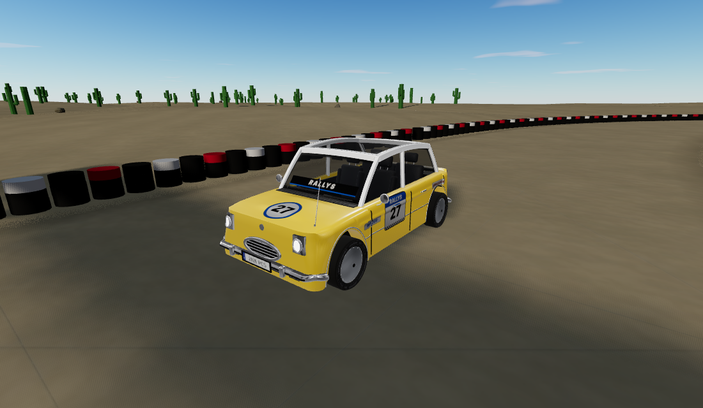
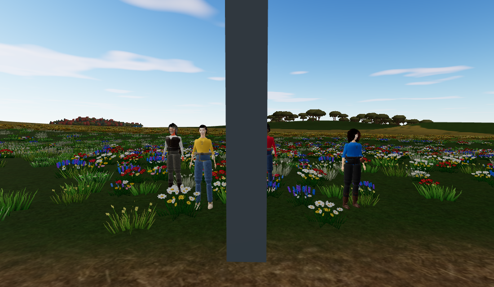
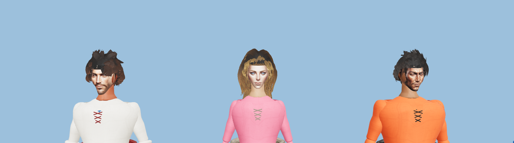
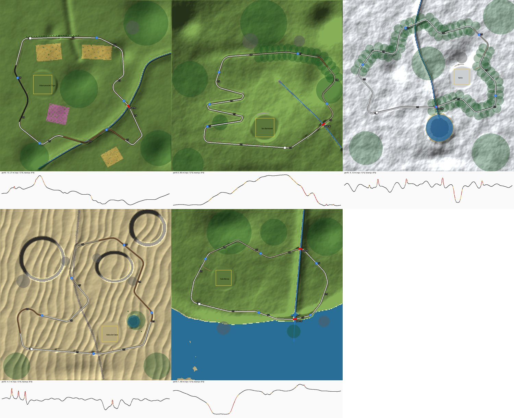
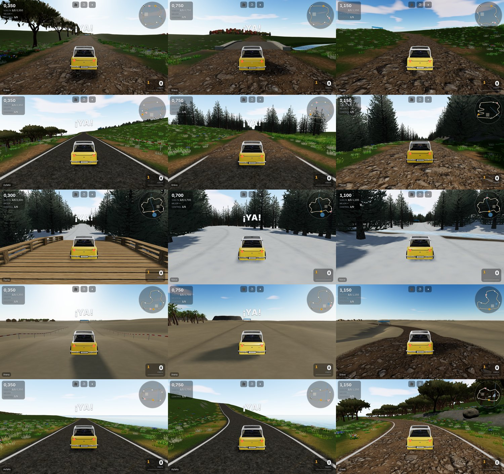
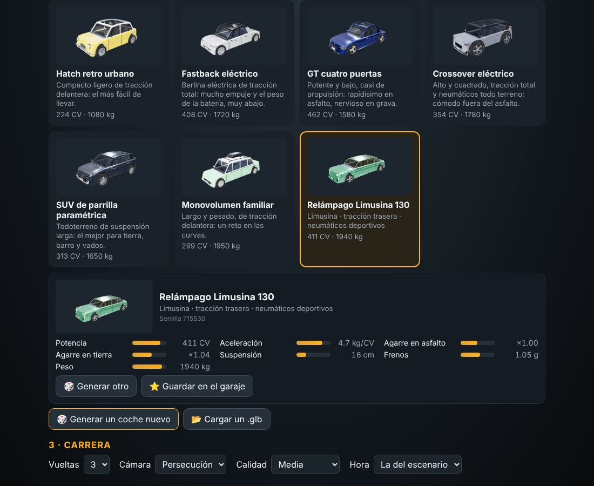
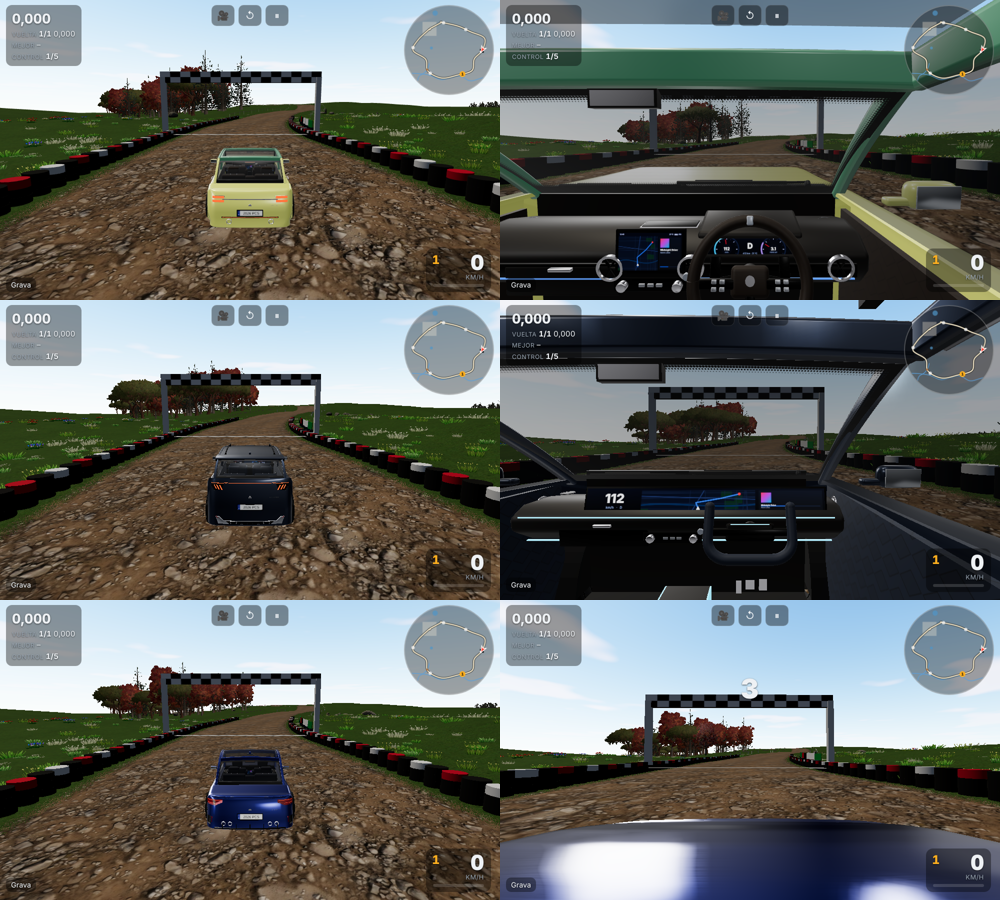
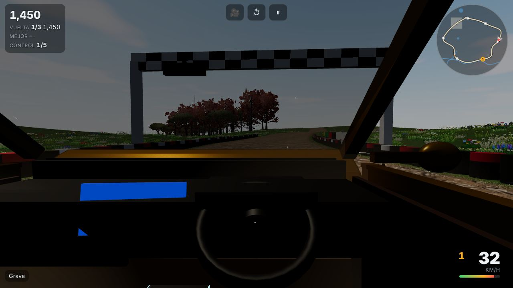
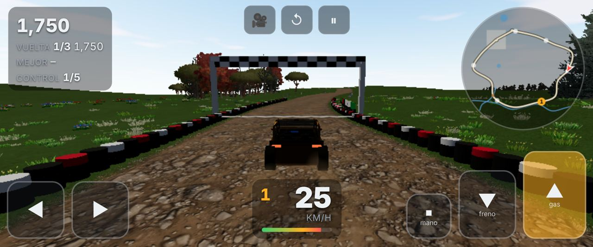

# Rallys

Juego de rallys en el navegador (JavaScript sin compilar, three.js 0.186.1 por importmap).
**Los escenarios se hacen en [Mundos-](https://github.com/narcimarquez-eng/Mundos-)** y los **coches en
[Hacer coches](https://github.com/narcimarquez-eng/Hacer-coches-)**: el juego no tiene editor, solo los carga.



## Cómo jugar
Sírvelo por web (GitHub Pages, o `python3 -m http.server` / `npm run servir` en esta carpeta) y abre `index.html`.
Elige escenario, coche, vueltas y cámara, y **¡A correr!** Sales del elemento «inicio» del escenario tras una cuenta
atrás; hay que pasar los **puntos de control en orden** y cruzar la **meta** en cada vuelta.

| | Teclado | Mando | Móvil |
|---|---|---|---|
| Acelerar / frenar y marcha atrás | W ↑ / S ↓ | RT / LT | pedales ▲ ▼ (derecha) |
| Girar | A D ← → | stick izquierdo o cruceta | ◀ ▶ (izquierda) |
| Freno de mano | Espacio | A o B | ⏹ mano |
| Cámara (persecución · capó · cabina) | C | Y | 🎥 |
| Volver a la pista | R | X | ↺ |
| Pausa · sonido | Esc / P · M | Start | ⏸ |
| Pantalla completa | F | | ⛶ |

**Ayudas a la conducción** (en el menú y en la pausa): *Altas* (por defecto: control de estabilidad y de tracción,
dirección tranquila a alta velocidad; el coche derrapa un poco pero no se cruza), *Medias* (deja derrapar más) y *Sin
ayudas* (la física tal cual: los coches potentes de tracción trasera se cruzan si se acelera en curva).

Escenarios que se pueden cargar:
- Los de `escenarios/indice.json`: la plantilla «rally» de Mundos- generada al vuelo (`"plantilla": "rally", "semilla": 4242`) o un `.escenario.json` exportado (`"archivo": …`).
- **📂 Abrir .escenario.json** (exportado con 💾 en Mundos-) o **🔗 una dirección web** a uno.
- `index.html?escenario=https://…/mi.escenario.json` abre ese directamente (también `&coche=retro&vueltas=3&camara=cabina&jugar`).
- Si el juego y Mundos- se publican en el mismo sitio (p. ej. los dos en `narcimarquez-eng.github.io`), salen además
  **los escenarios guardados en el Creador** (comparten el almacén del navegador).

Coches: los de `coches/indice.json` (exportados de Hacer coches, con su masa y potencia) o **📂 cualquier `.glb`**.
Los récords (mejor vuelta con sus parciales y mejor carrera por número de vueltas) se guardan en el navegador.

## Clasificación online y fantasmas
Cada mejor vuelta tuya se guarda con su **fantasma** (un coche semitransparente que repite la vuelta) y puedes correr
contra él o contra el de cualquiera de la **clasificación** del circuito. Con Supabase configurado (gratis, ver
[docs/ONLINE.md](docs/ONLINE.md)), las mejores vueltas se suben solas y ves tu puesto; sin él, todo funciona igual con
tus propias vueltas en el navegador.

## Carreras en grupo
**👥 Crear sala** y pasar el código o el enlace: de 2 a 8 pilotos corren a la vez por internet, cada uno con su coche,
viendo a los demás en la pista, en el minimapa y en la lista de puestos; al final, la clasificación de la carrera. Las
posiciones van directas entre jugadores (WebRTC) y la sala usa el mismo Supabase de la clasificación. Detalles en
[docs/GRUPO.md](docs/GRUPO.md). También hay **pantalla completa** (⛶ o F; en iPhone, «Añadir a pantalla de inicio»).


## Pegatinas y público
- **Pegatinas de rally** en todos los coches (también los generados y los de los demás en las carreras en grupo):
  la placa con el **dorsal** y RALLYS en las puertas, el dorsal en el capó (para leerlo de frente), en el techo (para
  la cámara de persecución) y detrás, la franja **RALLYS** en el parabrisas y los «patrocinadores» de la casa
  (Mundos-, Hacer coches y Armaduras). Se proyectan sobre la chapa (`juego/pegatinas.js`, DecalGeometry de three.js)
  buscándola con rayos, así que valen para cualquier carrocería; la placa de la puerta se baja o se achica hasta que
  cabe entera sin morder la ventanilla. Tu dorsal se elige en el menú («Dorsal», 1–99).
- **Público**: aficionados hechos con el generador de personajes de
  [Armaduras-glb](https://github.com/narcimarquez-eng/Armaduras-glb), en versión moderna: **caras amables** (sus
  rostros pintados sin cicatrices ni adornos y con media sonrisa: `tools/caras-amables.py`), **pelo de láminas con
  textura de mechones** (la técnica 5 del estudio, con sus peinados modernos) y **ropa de calle** (camisetas y sudaderas
  de colores, vaqueros, chupa de cuero, zapatillas…). Están en la **meta**, en cada **control** y en las **curvas más
  cerradas** (por dentro); esperan y, cuando pasa un coche, celebran o saltan. Se colocan solos detrás de la cuneta,
  nunca en el agua, en otro camino ni encima de árboles, rocas, casas o barreras (`juego/publico.js`). Se quitan con la
  casilla «Público».
  Cada uno tiene dos versiones (`aldeanos/`, exportadas con `tools/exportar-aldeanos.cjs`): la de lejos (~700 KB,
  ligera, solo los ojos pintados) y la de cerca (~1,3 MB, con la cara pintada entera), que se baja después y se pone
  cuando la cámara está a menos de 18 m (con calidad «Baja», nunca).





## Circuitos

Cinco circuitos **diseñados a mano** en Mundos- (`vendor/mundos/js/rally-disenado.js`; plantillas `rally_campos`,
`rally_puerto`, `rally_boreal`, `rally_tabernas` y `rally_acantilados`), más los dos de antes, hechos con la
plantilla «rally» aleatoria:

| Circuito | Largo | Desnivel | Carácter |
|---|---|---|---|
| 🌾 Campos de Castilla | 3,9 km | 38 m | Tierra y grava rápidas al atardecer: salto en la recta de salida, subida al cerro, puente de piedra, recta larga que acaba en horquilla, vado en la vaguada y pueblo blanco. |
| ⛰ Puerto del Pinsapar | 4,4 km | 80 m | Subida de asfalto con tres horquillas encadenadas, cresta con vistas, bajada de grava entre pinsapos con un repecho y puente romano. |
| 🌲 Bosque Boreal | 3,8 km | 12 m | Nieve entre pinsapos, curvas enlazadas y cuatro lomos para volar, puente de madera, vado y aldea nórdica. |
| 🏜 Rambla de Tabernas | 4,2 km | 7 m | Tres saltos en las dunas, el oasis con su poblado, el cañón entre dos mesetas de roca y la rambla seca. |
| 🌊 Costa de los Acantilados | 3,2 km | 45 m | Asfalto al borde del acantilado sobre el mar, puente de hierro sobre la cala y vuelta por grava entre pinos piñoneros. |

Qué tienen en común (lo que hace que se jueguen bien):
- **Ritmo**: rectas que acaban en frenadas fuertes, curvas de transición (sin cambios bruscos de volante), eses,
  horquillas, cambios de rasante y saltos donde se han querido, no donde caigan.
- **Pendientes de carretera**: las subidas se reparten por las horquillas y los tramos entre ellas; los puentes están a
  nivel (terraplén a la altura del tablero); los vados bajan al agua con rampas suaves y llevan 15–20 cm de agua.
- **Barreras con criterio**: paja o guardarraíl por fuera de las curvas cerradas, guardarraíl donde la carretera tiene
  caída a un lado, neumáticos en la salida y cinta donde hay público.
- **Controles** en el tramo más recto cerca de donde se piden, para que pasar por el arco no sea una lotería.
- **Siempre iguales**: el diseño fija el relieve y la posición de cada árbol (no dependen de una semilla).

`npm test` da una vuelta a cada uno con el piloto automático: llega a meta, pasa los cinco controles en orden, cruza el
puente por encima y el vado por el agua.




## Cómo se reutiliza Mundos- (decisión)
**Copia en `vendor/mundos/` con un script para actualizarla** (`tools/actualizar-mundos.sh`), en vez de cargarlo
desde donde esté publicado:
- El juego queda fijado a una versión probada de Mundos- (en `vendor/mundos/ORIGEN.txt` está el commit). Si Mundos-
  cambia algo, el juego no se rompe hasta que se actualiza a propósito.
- Funciona en local y en cualquier sitio, sin depender de que Mundos- esté publicado ni de qué rama sirve Pages.
- Se copian **sin tocar** los mismos módulos que usa el visor (`escenario-core.js`, `escena-3d.js`, vegetación,
  pradera, rocas, agua, suelos, pueblos3d y el generador de pueblos) y sus recursos (`assets/`, árboles, casas,
  puentes, la iglesia): ~30 MB. La página pone `<base href="vendor/mundos/">` para que las rutas relativas de
  Mundos- (`assets/…`, `glb/…`, `js/…`) funcionen igual que en el visor; el código del juego usa `import.meta.url`.

```bash
tools/actualizar-mundos.sh                       # desde ../Mundos- (carpeta de al lado)
tools/actualizar-mundos.sh --rama claude/world-generator-viewer-kk0hn3   # clonando esa rama
```
El escenario se dibuja con `Escena3D` de Mundos- tal cual, así que se ve igual que en el visor.

## Los coches de Hacer coches
Se usa el **creador realista**, el que está publicado en GitHub Pages
(<https://narcimarquez-eng.github.io/Hacer-coches-/Parametric%20Car%203D%20Studio%20(2).html>, ahora el commit `59f12ce`
de la rama `ccr-b02f9bfd-g5ar6l`): carrocería por
secciones, piezas modeladas en Blender incrustadas en la página, ópticas recortadas con booleanas…). La página
`parametric_car.html` de `main` es la versión antigua, de cajas, y ya no se usa.

```bash
tools/actualizar-hacer-coches.sh                 # copia el creador publicado en GitHub Pages (por defecto)
tools/actualizar-hacer-coches.sh --rama main     # u otra rama, o una carpeta: tools/actualizar-hacer-coches.sh ../Hacer-coches-
node tools/exportar-coches-fijos.cjs             # (con el juego servido en :8080) rehace coches/*.glb y sus fotos
```
`actualizar-hacer-coches.sh` copia la página **entera y sin tocarla** en `vendor/hacer-coches/creador.html` y solo le
añade al final un «puente» (`window.__rallys`) para pedirle coches desde el juego. Así, cuando el creador mejore, basta
con volver a ejecutarlo.

Formato del coche (lo que sale del creador, en `.glb` o directamente como grupo de three.js):
- **Metros**, **+Y arriba**, **morro hacia +Z**, suelo en y = 0 (las ruedas lo tocan).
- **Ruedas separadas**: `Wheel_FL`, `Wheel_FR`, `Wheel_RL`, `Wheel_RR` (buje, con la pinza de freno) y dentro
  `WheelSpin_…`, la parte que gira, con el origen en el centro de la rueda.
- El conductor va en −x (`SeatFront_-1`): de ahí sale la cámara de cabina; la de capó, delante del `Windshield`.

`juego/modelo-coche.js` lo encaja: detecta ruedas, ejes, batalla, vía, radio y medidas, saca cada rueda a un pivote
(dirección + giro + suspensión), pone la carrocería en otro (cabeceo y balanceo) y coloca las cámaras. Con otros
`.glb` busca las ruedas por forma y, si vienen en otra escala o «de lado», los corrige.

**Coches fijos** (`coches/`): los seis diseños del creador (fastback, crossover, hatch retro, GT cuatro puertas,
monovolumen y el SUV de parrilla paramétrica), exportados en su versión ligera (gltfpack, 2–3 MB cada uno). Sus datos
para la física (peso, potencia, tracción, suspensión, neumáticos) están en `coches/indice.json`.

## Coches generados al momento (🎲)

En el menú, **🎲 Generar un coche nuevo** crea un coche con el creador realista (lo mismo que su botón «🎲 Aleatorio»)
y le reparte unas **estadísticas al azar** que se ven en barras: potencia, aceleración (kg/CV), agarre en asfalto,
agarre en tierra, suspensión, frenos y peso, además del tipo de carrocería, la tracción y los neumáticos.

- El creador se abre **oculto en un `<iframe>`** (la primera vez tarda unos segundos: son 3 MB) y se le pide el coche.
  Su grupo de three.js se copia a este lado (`juego/generador-coche.js`) en vez de exportarlo a `.glb`: construirlo
  tarda menos de un segundo y exportarlo, mucho más.
- No son del todo al azar: la **carrocería** marca el peso, el recorrido de suspensión y la altura del centro de
  gravedad (un todoterreno pesa más y tiene más suspensión que un cupé), y el **dibujo de los neumáticos** marca el agarre
  (los de carreras agarran más en asfalto y menos en tierra; los todo terreno, al revés). Potencia, tracción (delantera,
  total o trasera), frenos y dirección salen al azar dentro de márgenes creíbles.
- Todo sale de una **semilla**: la misma semilla da el mismo coche y las mismas estadísticas. **⭐ Guardar en el
  garaje** guarda la semilla, la ficha y la foto (hasta 8 coches); el coche en 3D se vuelve a construir al correr.
  `?coche=gen:128394` en la dirección abre ese coche.
- La física tiene dos datos para los neumáticos, `agarreFirme` y `agarreSuelto`, que multiplican el agarre de cada
  superficie.




## Cómo está hecho (`juego/`)
| Archivo | Qué hace |
|---|---|
| `pista.js` | Qué hay bajo cada punto: altura por la que se rueda (terreno, cinta del camino, **rampas y tablero de los puentes**), superficie (tramos del camino, materiales del terreno, calles del pueblo) y agua (riachuelos con su **vado**, lagos, mar). |
| `coche.js` | Física arcade-creíble: **suspensión en las 4 ruedas** que sigue `alturaEn` y la pendiente (la carga de cada rueda sale de su muelle: en el aire no agarra), neumáticos con curva de agarre y círculo de fricción, **freno de mano para derrapar**, motor con curva de par, cambio automático de 6 marchas y marcha atrás, tracción total, gravedad en las cuestas, aire y arrastre del agua. Agarre: asfalto 1 > adoquín 0,86 > grava 0,74 > tierra 0,68 > hierba 0,55 > nieve 0,5 (neumáticos de clavos) > barro 0,48; agua 0,45 y frena. |
| `obstaculos.js` | Choques: troncos de árboles y rocas (leídos de lo que dibuja Mundos-), **casas, fuente y farolas del pueblo** (los `colliders` de su generador), **la iglesia** y demás `.glb` (su caja), cajas y muros, postes de meta y controles, **barreras** de los caminos (guardarraíl, muro, neumáticos… y la cinta y los conos, que solo frenan) y pretiles de los puentes. |
| `cronometro.js` | Salida, controles en orden, vueltas, meta, parciales contra la mejor vuelta y récords. Si el camino no es circuito, es un tramo de una pasada. |
| `camaras.js`, `controles.js`, `sonido.js`, `particulas.js` | Persecución/capó/cabina · teclado, mando y táctil · motor, superficie, derrape y golpes con Web Audio (sin archivos) · polvo, barro y salpicaduras. |
| `main.js` | Menú, carga, bucle (física a 120 Hz), HUD y minimapa, carreras en grupo y pantalla completa. `window.__rallys` deja probarlo desde la consola (piloto automático incluido). |
| `fantasma.js`, `clasificacion.js` | Fantasmas (grabación, formato compacto y el coche semitransparente) y clasificación online en Supabase ([docs/ONLINE.md](docs/ONLINE.md)). |
| `pegatinas.js`, `publico.js` | Pegatinas de rally proyectadas sobre la carrocería y el público (aldeanos de Armaduras-glb) en los puntos clave. |
| `sala.js`, `rivales.js` | Carreras en grupo: la sala (Supabase Realtime + WebRTC) y los coches de los demás, interpolados ([docs/GRUPO.md](docs/GRUPO.md)). |

`npm test` prueba sin navegador una vuelta entera con piloto automático (los 5 controles en orden, el puente por
encima del cauce, asfalto/grava/adoquín y la meta) y un choque contra el guardarraíl.

## Plan por fases
1. ✅ **Base**: escenario de Mundos- dibujado igual que en el visor, coche de Hacer coches, salida desde «inicio».
2. ✅ **Física**: suspensión, derrapes, superficies, cuestas, puentes y vado.
3. ✅ **Choques**: barreras, casas, iglesia, árboles y rocas.
4. ✅ **Carrera**: controles en orden, vueltas, meta, parciales, récords, resultados.
5. ✅ **Cámaras, controles (teclado, mando, táctil) y sonido.**
6. Siguiente: afinar el tacto de la conducción jugando de verdad, marcas de neumáticos, daños visuales, fantasma de
   la mejor vuelta, repetición, rivales con IA sobre `muestrearCamino`, más coches y escenarios.

## Qué falta en Mundos- (para hacerlo allí aparte)
1. **La pista atraviesa casas al salir del pueblo.** `atravesarPueblo` pone las salidas en un ángulo, pero el
   generador del pueblo dibuja la calle de salida en otro sitio: en el escenario de ejemplo (semilla 4242) la pista
   sale hacia el noreste cruzando dos manzanas, mientras la calle real sale hacia el este. Se ve en
   `docs/capturas/pueblo-aereo.jpg` (en rojo, las formas de choque; en azul, la línea de la pista). Hay que hacer que la
   calle de salida del generador vaya exactamente por donde pasa el camino (o no poner casas sobre él).
2. **Datos de choque en el núcleo**: una función tipo `Escenario.obstaculos(esc)` (troncos, rocas, solares de los
   `.glb`, casas del pueblo sin necesidad de construirlo en 3D). Ahora el juego los lee de lo dibujado.
3. **Altura de la calzada en el núcleo**: `Escenario.alturaCaminoEn(esc, x, z)` con las rampas y el perfil del tablero
   de los puentes (ahora el juego reproduce la lógica de `_mallaCamino`). Y **rampas de los puentes más largas**: son
   de 3× la altura del tablero (≈ 25°), y a más de 40 km/h el coche salta.
4. **Botón «🏁 Probar en Rallys»** en el editor que abra el juego con el escenario actual.
5. Opcional: que las rutas de recursos se puedan basar en una carpeta (en vez de relativas a la página), para no
   necesitar el `<base>`.
6. Nota: la plantilla «rally» con la semilla 4242 no tiene vado (el riachuelo no cruza la pista); con la 123 sí
   (escenario «Valle de las Encinas»). Y en `setHora`, a las 18:30 ya es de noche.

## Qué falta en Hacer coches
1. `main` sigue con el creador antiguo: la versión buena es la de Pages (rama `ccr-b02f9bfd-g5ar6l`).
2. Guardar en `extras` del glTF los datos del coche (batalla, vía, radio, asiento del conductor, masa y potencia
   sugeridas) y que el aleatorio sortee también el dibujo de los neumáticos (ahora lo pone el puente del juego).
3. Exportar el `.glb` es lento (unos 20 s en un ordenador sin tarjeta gráfica): se va en las texturas.

## Capturas (Playwright)
| | |
|---|---|
|  |  |
|  |  |
|  |  |
|  |  |
