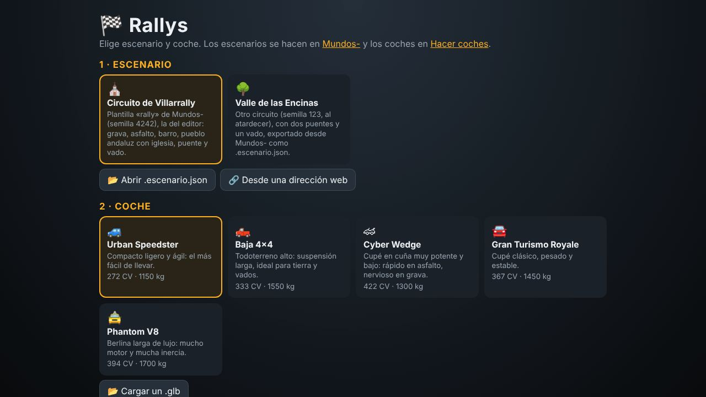
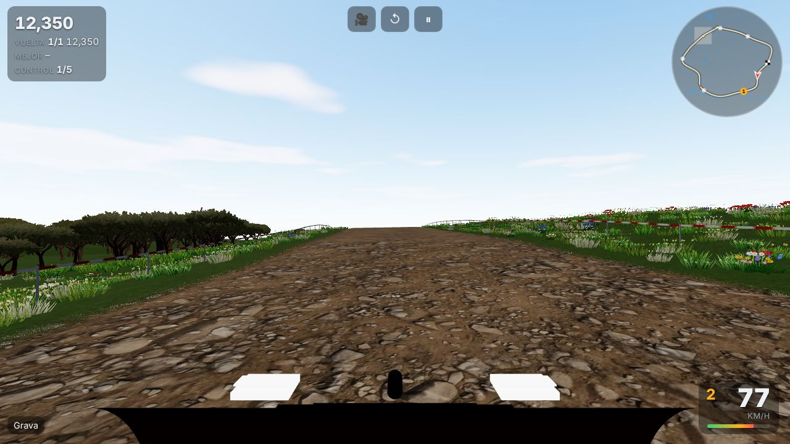
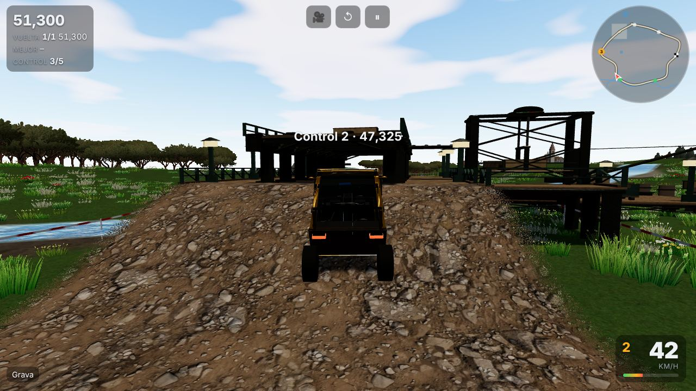
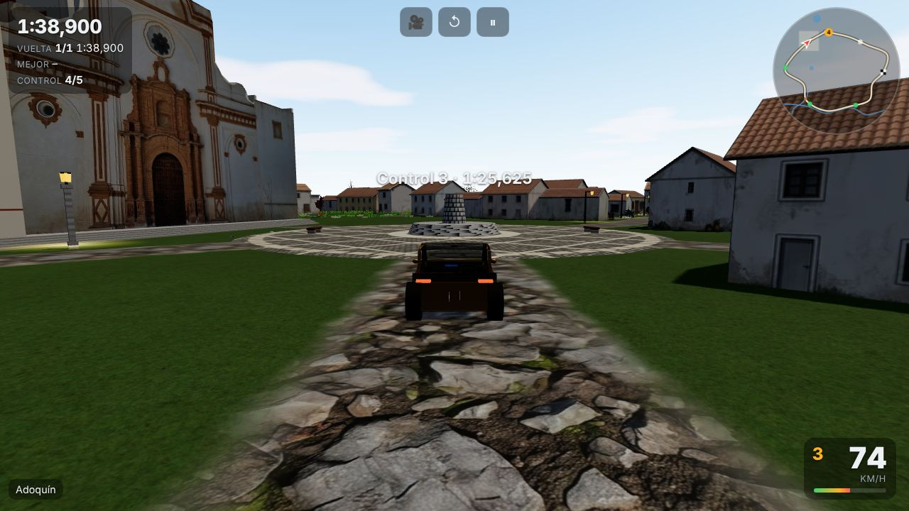
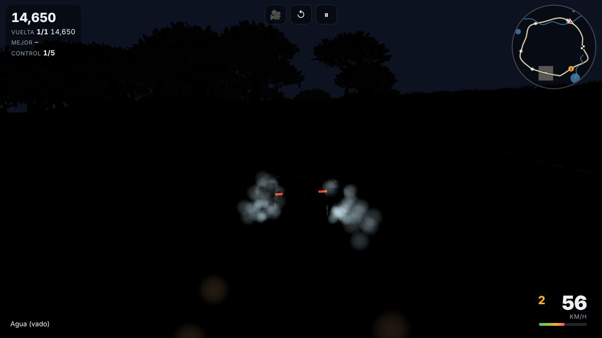
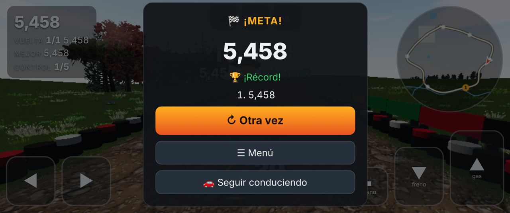

# Rallys

Juego de rallys en el navegador (JavaScript sin compilar, three.js 0.186.1 por importmap).
**Los escenarios se hacen en [Mundos-](https://github.com/narcimarquez-eng/Mundos-)** y los **coches en
[Hacer coches](https://github.com/narcimarquez-eng/Hacer-coches-)**: el juego no tiene editor, solo los carga.


## Cómo jugar
Sírvelo por web (GitHub Pages, o `python3 -m http.server` / `npm run servir` en esta carpeta) y abre `index.html`.
Elige escenario, coche, vueltas y cámara, y **¡A correr!** Sales del elemento «inicio» del escenario tras una cuenta
atrás; hay que pasar los **puntos de control en orden** y cruzar la **meta** en cada vuelta.

| | Teclado | Mando | Móvil |
|---|---|---|---|
| Acelerar / frenar y marcha atrás | W ↑ / S ↓ | RT / LT | pedales ▲ ▼ (derecha) |
| Girar | A D ← → | stick izquierdo o cruceta | ◀ ▶ (izquierda) |
| Freno de mano | Espacio | A o B | ⏹ mano |
| Cámara (persecución · capó · cabina) | C | Y | 🎥 |
| Volver a la pista | R | X | ↺ |
| Pausa · sonido | Esc / P · M | Start | ⏸ |

Escenarios que se pueden cargar:
- Los de `escenarios/indice.json`: la plantilla «rally» de Mundos- generada al vuelo (`"plantilla": "rally", "semilla": 4242`) o un `.escenario.json` exportado (`"archivo": …`).
- **📂 Abrir .escenario.json** (exportado con 💾 en Mundos-) o **🔗 una dirección web** a uno.
- `index.html?escenario=https://…/mi.escenario.json` abre ese directamente (también `&coche=urban&vueltas=3&camara=cabina&jugar`).
- Si el juego y Mundos- se publican en el mismo sitio (p. ej. los dos en `narcimarquez-eng.github.io`), salen además
  **los escenarios guardados en el Creador** (comparten el almacén del navegador).

Coches: los de `coches/indice.json` (exportados de Hacer coches, con su masa y potencia) o **📂 cualquier `.glb`**.
Los récords (mejor vuelta con sus parciales y mejor carrera por número de vueltas) se guardan en el navegador.

## Cómo se reutiliza Mundos- (decisión)
**Copia en `vendor/mundos/` con un script para actualizarla** (`tools/actualizar-mundos.sh`), en vez de cargarlo
desde donde esté publicado:
- El juego queda fijado a una versión probada de Mundos- (en `vendor/mundos/ORIGEN.txt` está el commit). Si Mundos-
  cambia algo, el juego no se rompe hasta que se actualiza a propósito.
- Funciona en local y en cualquier sitio, sin depender de que Mundos- esté publicado ni de qué rama sirve Pages.
- Se copian **sin tocar** los mismos módulos que usa el visor (`escenario-core.js`, `escena-3d.js`, vegetación,
  pradera, rocas, agua, suelos, pueblos3d y el generador de pueblos) y sus recursos (`assets/`, árboles, casas,
  puentes, la iglesia): ~30 MB. La página pone `<base href="vendor/mundos/">` para que las rutas relativas de
  Mundos- (`assets/…`, `glb/…`, `js/…`) funcionen igual que en el visor; el código del juego usa `import.meta.url`.

```bash
tools/actualizar-mundos.sh                       # desde ../Mundos- (carpeta de al lado)
tools/actualizar-mundos.sh --rama claude/world-generator-viewer-kk0hn3   # clonando esa rama
```
El escenario se dibuja con `Escena3D` de Mundos- tal cual, así que se ve igual que en el visor.

## Los coches de Hacer coches
`parametric_car.html` → «⬇ Exportar GLB» (GLTFExporter, binario):
- **Metros**, **+Y arriba**, **morro hacia +Z**, suelo en y = 0 (las ruedas lo tocan).
- Raíz `LuxuryCar` con `Body`, `Cabin`, `FrontDetails`, `RearDetails`, `SideDetails`, `Interior` y `Wheels`.
- **Ruedas separadas**: 4 grupos `Wheel` con el origen en el centro de la rueda, en (±vía/2, radio, ±eje). Todas se
  llaman igual: el juego las distingue por su posición (x > 0 izquierda, z > 0 delante).
- El conductor va en −x (`SeatCushionF_-1`, volante a ese lado): de ahí sale la cámara de cabina.

`juego/modelo-coche.js` lo encaja: detecta ruedas, ejes, batalla, vía, radio y medidas, saca cada rueda a un pivote
(dirección + giro + suspensión), pone la carrocería en otro (cabeceo y balanceo) y coloca las cámaras de capó
(delante del parabrisas `Windshield`) y cabina. Con otros `.glb` busca las ruedas por forma y, si vienen en otra
escala o «de lado», los corrige. `tools/` no exporta coches: los `.glb` de `coches/` se sacaron con el botón de
exportar de Hacer coches (las cinco de su colección).

## Cómo está hecho (`juego/`)
| Archivo | Qué hace |
|---|---|
| `pista.js` | Qué hay bajo cada punto: altura por la que se rueda (terreno, cinta del camino, **rampas y tablero de los puentes**), superficie (tramos del camino, materiales del terreno, calles del pueblo) y agua (riachuelos con su **vado**, lagos, mar). |
| `coche.js` | Física arcade-creíble: **suspensión en las 4 ruedas** que sigue `alturaEn` y la pendiente (la carga de cada rueda sale de su muelle: en el aire no agarra), neumáticos con curva de agarre y círculo de fricción, **freno de mano para derrapar**, motor con curva de par, cambio automático de 6 marchas y marcha atrás, tracción total, gravedad en las cuestas, aire y arrastre del agua. Agarre: asfalto 1 > adoquín 0,86 > grava 0,74 > tierra 0,68 > hierba 0,55 > barro 0,48; agua 0,45 y frena. |
| `obstaculos.js` | Choques: troncos de árboles y rocas (leídos de lo que dibuja Mundos-), **casas, fuente y farolas del pueblo** (los `colliders` de su generador), **la iglesia** y demás `.glb` (su caja), cajas y muros, postes de meta y controles, **barreras** de los caminos (guardarraíl, muro, neumáticos… y la cinta y los conos, que solo frenan) y pretiles de los puentes. |
| `cronometro.js` | Salida, controles en orden, vueltas, meta, parciales contra la mejor vuelta y récords. Si el camino no es circuito, es un tramo de una pasada. |
| `camaras.js`, `controles.js`, `sonido.js`, `particulas.js` | Persecución/capó/cabina · teclado, mando y táctil · motor, superficie, derrape y golpes con Web Audio (sin archivos) · polvo, barro y salpicaduras. |
| `main.js` | Menú, carga, bucle (física a 120 Hz), HUD y minimapa. `window.__rallys` deja probarlo desde la consola (piloto automático incluido). |

`npm test` prueba sin navegador una vuelta entera con piloto automático (los 5 controles en orden, el puente por
encima del cauce, asfalto/grava/adoquín y la meta) y un choque contra el guardarraíl.

## Plan por fases
1. ✅ **Base**: escenario de Mundos- dibujado igual que en el visor, coche de Hacer coches, salida desde «inicio».
2. ✅ **Física**: suspensión, derrapes, superficies, cuestas, puentes y vado.
3. ✅ **Choques**: barreras, casas, iglesia, árboles y rocas.
4. ✅ **Carrera**: controles en orden, vueltas, meta, parciales, récords, resultados.
5. ✅ **Cámaras, controles (teclado, mando, táctil) y sonido.**
6. Siguiente: afinar el tacto de la conducción jugando de verdad, marcas de neumáticos, daños visuales, fantasma de
   la mejor vuelta, repetición, rivales con IA sobre `muestrearCamino`, más coches y escenarios.

## Qué falta en Mundos- (para hacerlo allí aparte)
1. **La pista atraviesa casas al salir del pueblo.** `atravesarPueblo` pone las salidas en un ángulo, pero el
   generador del pueblo dibuja la calle de salida en otro sitio: en el escenario de ejemplo (semilla 4242) la pista
   sale hacia el noreste cruzando dos manzanas, mientras la calle real sale hacia el este. Se ve en
   `docs/capturas/pueblo-aereo.jpg` (en rojo, las formas de choque; en azul, la línea de la pista). Hay que hacer que la
   calle de salida del generador vaya exactamente por donde pasa el camino (o no poner casas sobre él).
2. **Datos de choque en el núcleo**: una función tipo `Escenario.obstaculos(esc)` (troncos, rocas, solares de los
   `.glb`, casas del pueblo sin necesidad de construirlo en 3D). Ahora el juego los lee de lo dibujado.
3. **Altura de la calzada en el núcleo**: `Escenario.alturaCaminoEn(esc, x, z)` con las rampas y el perfil del tablero
   de los puentes (ahora el juego reproduce la lógica de `_mallaCamino`). Y **rampas de los puentes más largas**: son
   de 3× la altura del tablero (≈ 25°), y a más de 40 km/h el coche salta.
4. **Botón «🏁 Probar en Rallys»** en el editor que abra el juego con el escenario actual.
5. Opcional: que las rutas de recursos se puedan basar en una carpeta (en vez de relativas a la página), para no
   necesitar el `<base>`.
6. Nota: la plantilla «rally» con la semilla 4242 no tiene vado (el riachuelo no cruza la pista); con la 123 sí
   (escenario «Valle de las Encinas»). Y en `setHora`, a las 18:30 ya es de noche.

## Qué falta en Hacer coches
1. Al exportar se cuelan **la caja azul de selección** (si hay una zona elegida) y **las luces** de las ruedas y la
   cabina; varias piezas pequeñas salen con **vértices NaN**. El juego las quita, pero conviene arreglarlo allí.
2. **Nombrar las ruedas** (`Rueda_DI`, `Rueda_DD`, `Rueda_TI`, `Rueda_TD`) y guardar en `extras` del glTF los datos
   del coche (batalla, vía, radio, asiento del conductor, masa y potencia sugeridas).
3. Un botón para **exportar toda la colección** de una vez.

## Capturas (Playwright)
| | |
|---|---|
|  |  |
|  |  |
|  |  |
|  |  |
