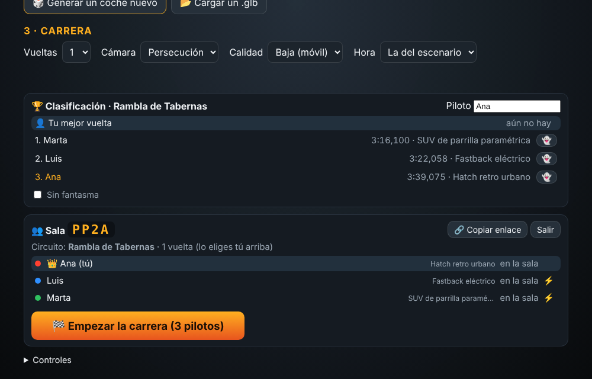
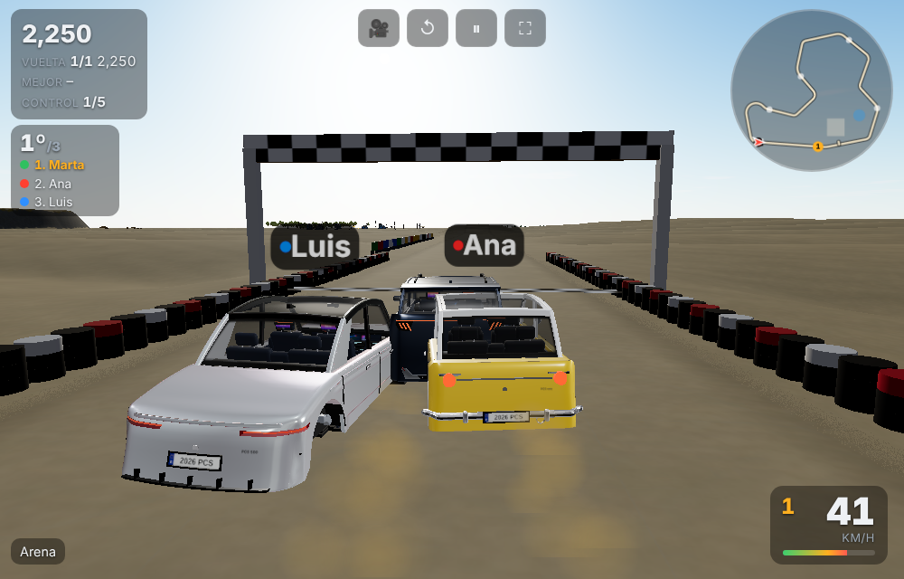
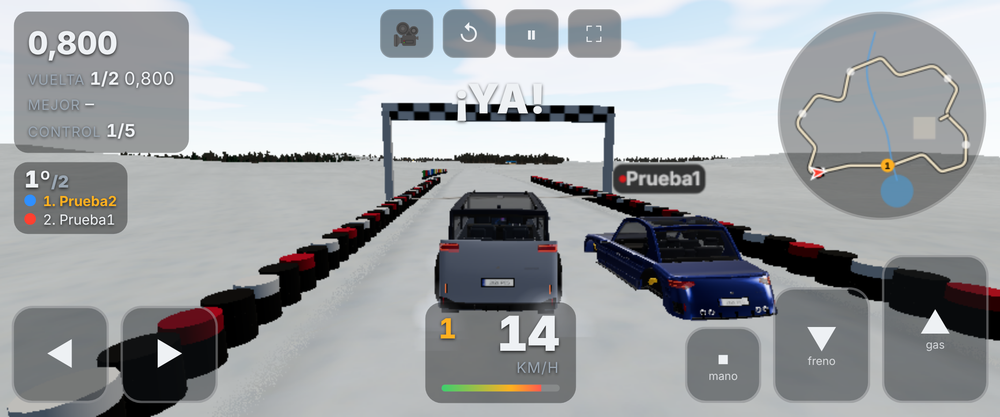

# Carreras en grupo (por internet)

Varios jugadores (de 2 a 8) corren **a la vez** el mismo circuito, cada uno desde su ordenador o móvil, viendo a los
demás moverse en tiempo real.

## Cómo se juega
1. Pon tu **nombre de piloto** (en el menú, en la clasificación).
2. Uno pulsa **➕ Crear sala**. Sale un código de 4 letras (p. ej. **RX7K**) y un botón **🔗 Copiar enlace**: pásalo
   por WhatsApp o lo que sea.
3. Los demás abren el enlace (o escriben el código y pulsan **Unirse**).
4. En la sala se ve quién está, con qué coche y si hay conexión directa con él (⚡) o va por el servidor (☁).
   - El **anfitrión** (👑, el que creó la sala) elige el **circuito y las vueltas** en el menú de siempre; a los demás
     se les pone solo.
   - Cada uno elige **su coche** (también los generados 🎲: los demás lo construyen con su semilla).
5. El anfitrión pulsa **🏁 Empezar la carrera**. Todos cargan el circuito; cuando están todos en la parrilla (o a los
   90 s, por si alguien se ha quedado colgado) empieza la **cuenta atrás a la vez**.
6. En carrera: tu **puesto** (1º/3) y la lista de pilotos debajo de los tiempos, los demás en el minimapa (puntos de
   colores) y en la pista con su nombre encima. **No hay choques entre coches**: se atraviesan como fantasmas (con el
   retraso de internet, los choques entre jugadores salen injustos).
7. En la meta, la clasificación de la carrera, que se va completando según llegan los demás. **↩ Volver a la sala**
   para la siguiente.

Notas:
- **La pausa no para la carrera** (los demás siguen): tu coche frena solo. Desde la pausa puedes **dejar la carrera**.
- Quien entra en la sala con una carrera en marcha corre la siguiente.
- Si alguien se desconecta un rato (el móvil se bloquea, se va la cobertura), vuelve solo a la sala al recuperar la
  conexión; si cierra el juego, su coche desaparece y en los resultados sale «retirado».
- Tu mejor vuelta también cuenta para la clasificación general del circuito, como siempre.
- Necesita la clasificación online configurada ([ONLINE.md](ONLINE.md)): las salas usan el mismo proyecto de Supabase.

## Pantalla completa
Botón **⛶** (en el menú, en la pausa y arriba en carrera) o la tecla **F**. En el móvil, además, gira a horizontal.
En **iPhone** Safari no deja poner una página a pantalla completa: usa **Compartir → «Añadir a pantalla de inicio»** y
abre Rallys desde ese icono (se abre a pantalla completa, como una aplicación; en Android también se puede).

## Cómo está hecho
- **La sala** (`juego/sala.js`) es un canal de **Supabase Realtime** (`rallys:<CÓDIGO>`):
  - con su **presencia** cada jugador publica quién es: nombre, coche, fase (en la sala, cargando, en la salida,
    corriendo, en meta) y, al llegar, su tiempo. Así los resultados no se pierden aunque un mensaje sí.
  - por sus **mensajes** van las órdenes del anfitrión (cargar el circuito, salida) y la señalización de WebRTC.
  - El anfitrión es el que lleva más tiempo en la sala: si se va, lo es el siguiente.
- **Las posiciones** van **directas entre jugadores por WebRTC** (un DataChannel sin reenvíos, 15 veces por segundo,
  48 bytes: posición, rumbo, cabeceo, balanceo, dirección, velocidad y lo recorrido). No pasan por Supabase, así que no
  gastan su cupo de mensajes y llegan antes.
- **Plan B**: si dos jugadores no consiguen conectarse directamente en 8 s (algunas redes de empresa o de datos
  móviles no lo permiten sin un servidor TURN), la posición va por el canal de Supabase, 5 veces por segundo. Se ve un
  poco menos suave, pero se juega. El plan gratuito de Supabase da 2 millones de mensajes al mes: de sobra para
  jugar así de vez en cuando.
- **Los coches de los demás** (`juego/rivales.js`) se dibujan 0,12 s en el pasado, interpolando entre las dos muestras
  que lo rodean (el reloj de cada uno se estima con las propias muestras), así que se mueven suaves aunque los paquetes
  lleguen a tirones.
- **El puesto** se calcula con lo recorrido: vueltas y controles pasados, y lo que falta por carretera al siguiente.
- Supabase avisa de que cierra el canal a quien publica su presencia demasiado a menudo: se publica como mucho cada
  0,4 s (lo último).
- `?p2p=0` en la dirección fuerza el plan B (para probarlo) y `?depurar` saca en la consola lo que pasa en la sala.

Pruebas: `test/grupo.test.mjs` (la sala con un Supabase Realtime simulado: presencia, anfitrión, órdenes, plan B a
5 Hz y el orden de los puestos). La carrera completa de 3 jugadores se probó con Playwright contra Supabase de verdad
(conexión directa entre los tres, cuenta atrás a la vez, puestos, resultados con los tres tiempos), el plan B y la
vuelta a la sala tras un corte de más de un minuto.
