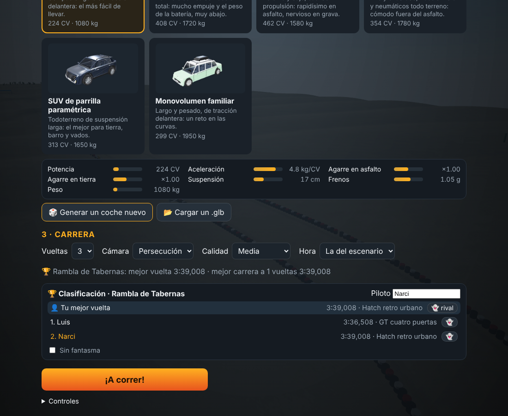
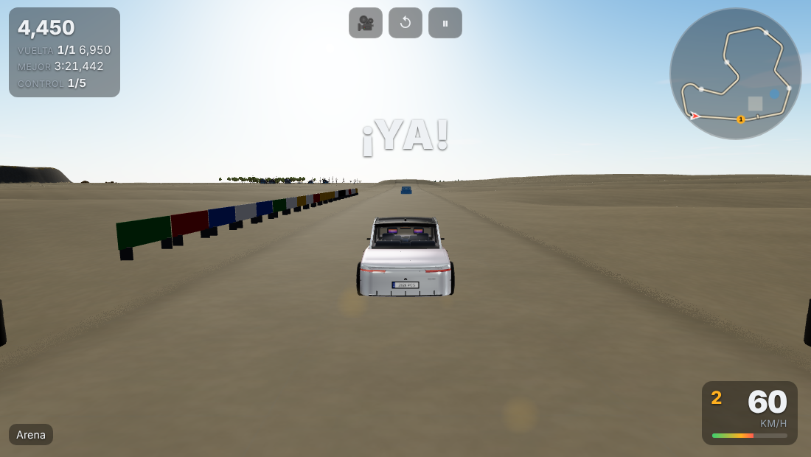

# Clasificación online y fantasmas

## Qué hace
- Cada vuelta se graba (20 veces por segundo: posición, rumbo, cabeceo, balanceo y dirección). Si es **tu mejor vuelta**
  en ese circuito, se guarda con su **fantasma** en el navegador (`localStorage`), con o sin internet.
- En el menú, bajo «3 · Carrera», está la **clasificación** del circuito elegido, tu nombre de piloto y el **rival
  fantasma**: tu mejor vuelta (por defecto), la de cualquiera de la clasificación (botón 👻) o ninguno.
- En carrera, el fantasma es un coche semitransparente que repite su vuelta; en cada control se ve la diferencia con
  él (👻 −1,234 / +0,567).
- Con la clasificación online configurada y tu nombre puesto, cada nueva mejor vuelta tuya se **sube sola**, y en la
  pantalla de resultados sale tu puesto.

Cada circuito tiene su clasificación por **versión**: una huella del trazado. Si el circuito cambia (otra versión de
Mundos-), empieza una clasificación nueva y los fantasmas viejos no se mezclan.




## Activar la clasificación online (Supabase, gratis)
1. Crea una cuenta y un proyecto en <https://supabase.com> (el plan gratuito basta; elige la región más cercana).
2. En el proyecto: **SQL Editor → New query**, pega todo [`online/supabase.sql`](../online/supabase.sql) y pulsa
   **Run**. Crea la tabla `vueltas` con sus reglas.
3. En **Project Settings → API** (o «Data API» / «API Keys»), copia:
   - la **Project URL** (`https://xxxxxxxx.supabase.co`),
   - la clave **anon public** (también llamada *publishable*).
4. Ponlas en [`juego/online.config.js`](../juego/online.config.js) y súbelo (o pásaselas a Claude para que lo haga).

La clave *anon* es pública: está pensada para ir en la página, a la vista de todos, y lo que permite lo deciden las
reglas de la tabla (leer y añadir vueltas; nada de cambiar ni borrar). **Nunca** pongas la clave *service_role* (o
*secret*): esa da acceso total.

## Límites (es un juego entre amigos)
- Como el juego corre en tu navegador, alguien con conocimientos podría subir un tiempo falso. Las reglas solo
  impiden datos absurdos (tiempos de menos de 20 s, nombres larguísimos, fantasmas enormes). Las vueltas falsas se
  pueden borrar a mano en Supabase (Table Editor). Si algún día hace falta, se puede validar el fantasma en el
  servidor (una *Edge Function* que compruebe que pasa por los controles y no va más rápido de lo posible).
- Un proyecto gratuito de Supabase se pausa tras una semana sin uso: se reactiva desde su panel.

## Para probar sin tocar el código
En la consola del navegador:
```js
localStorage.setItem('rallys.online', JSON.stringify({ url: 'https://xxxxxxxx.supabase.co', clave: 'la clave anon' }))
```
y recarga. `localStorage.removeItem('rallys.online')` lo quita.

## Cómo está hecho
- `juego/fantasma.js`: grabación (`Grabadora`), formato compacto (`codificar` / `decodificar`: diferencias en
  centímetros y diezmilésimas de radián, comprimidas con gzip; unos 10 KB por minuto de vuelta) y el coche fantasma
  en la escena.
- `juego/clasificacion.js`: la mejor vuelta local y la API REST de Supabase (`/rest/v1/vueltas`).
- `test/online.test.mjs`: el formato (precisión de 2 cm) y la clasificación contra un Supabase simulado.
